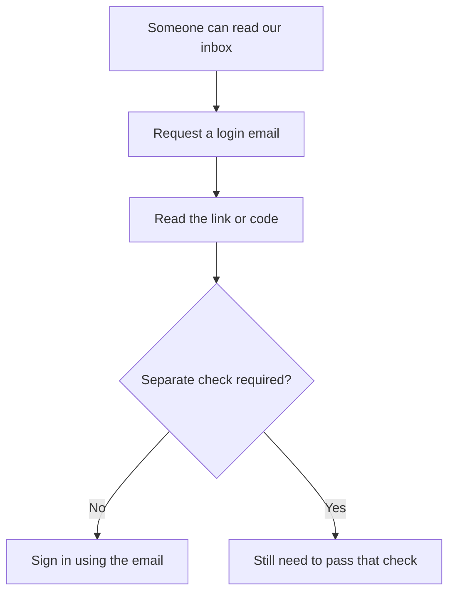

I open a website on my phone and tap sign in. There's an email field, but no password field. Oh Christ, here we go again.

Apparently, the simple act of signing in now requires this:

1. Let the password manager fill in my email address. That's about as much use as I'm getting out of it here.
2. Be told a login email is on its way.
3. Switch to my email app.
4. Refresh and wait like a Stone Age man, only with a touchscreen.
5. Copy the fiddly, spaced-out code with enough styling to qualify as a small web-design project.
6. Return to the browser and paste it into the field-per-digit monstrosity they've crafted.
7. Be asked where I want to sign in, despite having started on the bloody website.

This is why compulsory email login is crap design, particularly on a phone. I want a password my password manager can fill, with proper two-factor authentication (2FA), or a passkey that avoids the password altogether. Making everyone fetch an email instead is an affront to convenience and common sense.

## The app-switching gets worse

Signing in to an app through a browser, using OAuth, adds another lap of this little obstacle course. Now I have to return to the original app to paste the code, whilst the website often loses track of what I was trying to sign in to. I've already told it where I want to go, by starting there.

Anthropic is a particularly irritating example. I get the same email-verification faff across its sign-ins, and they're all equally annoying. Its [Claude sign-in guide](https://support.claude.com/en/articles/13189465-log-in-to-your-claude-account) says we can't create a dedicated Claude password.

For Claude's email route, opening the link on the original device signs us in directly; opening it on another device gives us a code to enter on the original one. Either way, we still need the email to arrive before we can get on with what we were doing.

If it doesn't arrive, Anthropic's troubleshooting advice includes the missing-newsletter routine: check spam, junk and quarantined mail, then try again after a few minutes. All this to avoid letting a password manager fill a password I wasn't going to type anyway.

## It's also ridiculously insecure

Keep the same example, but suppose someone else can read our mailbox. Requesting a login email sends them the credential just as effectively as it sends it to us.

What happens next depends on whether the website requires anything else:

For accounts where the email alone is sufficient, we've carefully avoided reusing passwords by reusing access to the same mailbox. The attacker doesn't need to discover a separate password for each service because there's another way in.

Encrypting email during delivery doesn't fix that. [TLS can protect transmission](https://support.google.com/transparencyreport/answer/7381230?hl=en), but it isn't end-to-end message encryption, and it doesn't prevent someone with inbox access from reading the delivered message.

[NIST's digital identity guidance](https://pages.nist.gov/800-63-4/sp800-63b.html#out-of-band) puts its objection plainly:

> Email SHALL NOT be used for out-of-band authentication.

Its reasons include password-only access to mailboxes and interception. Protecting your mailbox with MFA helps, of course, but the destination website is still relying on access to that mailbox rather than requiring its own independent proof.

## Give me another way in

Let's change that same sign-in screen. The choices I'd put on it are hardly outrageous:

- **Use a passkey:** confirm the sign-in on our device, without fetching an email.
- **Use a password and 2FA:** let a password manager fill a unique password, then use a separate authenticator app or security key.
- **Use email:** receive a link or code, for people who choose that route.

At least give me the option of using a fucking password with proper 2FA, rather than doing all this to avoid one.

Email isn't the price we have to pay for going passwordless. [Passkeys](https://fidoalliance.org/passkeys/) let us sign in using a device or authenticator, without remembering a password or waiting for a message. They're also tied to the real website, rather than giving us a code we can be tricked into entering on a lookalike.

A password and a separate authenticator-app code are also a useful choice. Those codes can be phished, but someone who can read our email would still need that separate code.

Then I'd add the setting that makes the stronger choice mean something: **email-only sign-in off**. Adding a passkey whilst retaining unrestricted email access is a lovely new lock beside the same open window. We need to close that route, not merely put another button next to it.

## Recovery mustn't undo the protection

Now, you could argue that password accounts already have email resets. Yes, but resetting a password needn't remove the separate authentication requirement.

For our redesigned account, someone who controls the mailbox gets this far:

1. Request a password reset.
2. Follow the email and choose a new password.
3. Still have to provide the independent second factor before signing in.

Remove that last step and we've made 2FA compulsory for the legitimate user but optional for the attacker. An impressively backwards allocation of effort.

[GitHub's recovery documentation](https://docs.github.com/en/authentication/securing-your-account-with-two-factor-authentication-2fa/recovering-your-account-if-you-lose-your-2fa-credentials) makes this distinction: resetting the password doesn't, by itself, recover the second factor.

Of course, we also need a way back in if we lose our phone or security key. I'd let us register a second authenticator and save single-use recovery codes somewhere safe, rather than making email a shortcut around the protection we chose. [OWASP's passkey guidance](https://cheatsheetseries.owasp.org/cheatsheets/Passkey_Security_Cheat_Sheet.html#account-recovery-and-bootstrap) treats recovery as part of the same security problem.

Lose every authenticator and every recovery code, and there's no instant inbox-only rescue in this proposal. That's the consequence of making the stronger protection apply to recovery too.

## My verdict

I want websites to stop making the inbox compulsory. Keep email login for people who want it, but offer a passkey or a password with proper 2FA, and let choosing that protection remove email-only access.

For anyone already using a password manager or ready to use passkeys, those alternatives are worth having. Websites should make them easy to use and provide recovery that doesn't undo the protection. Anthropic should offer that choice instead of sending me off to check my email again.

I'm perfectly capable of wasting my own time.
