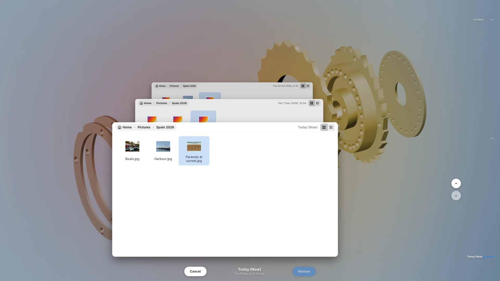
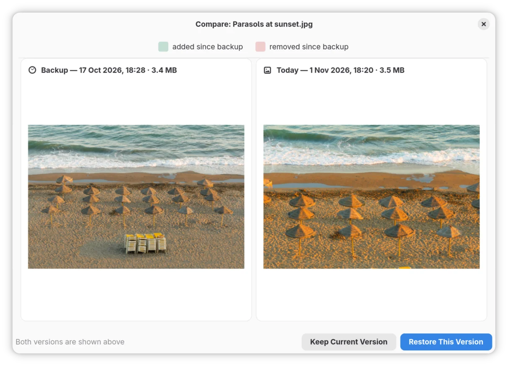
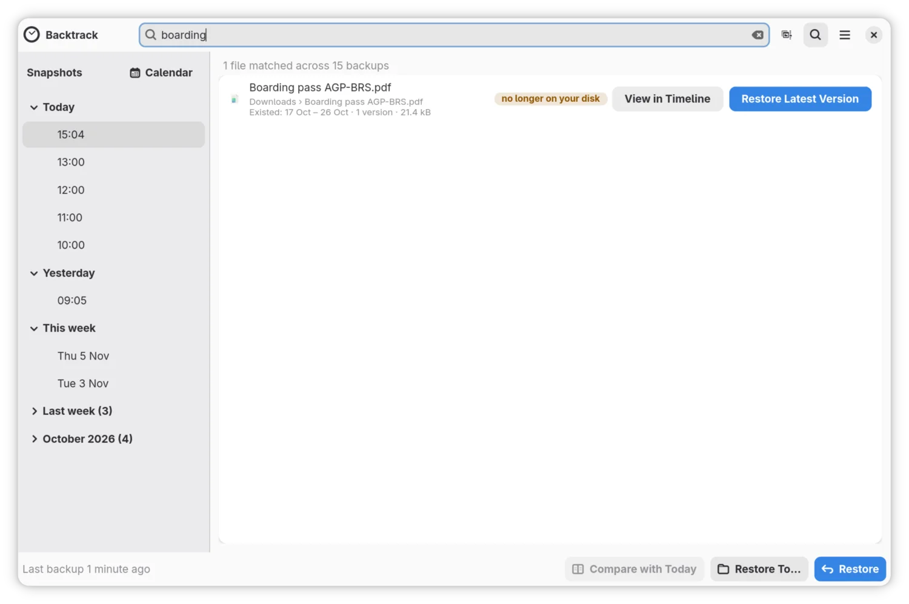
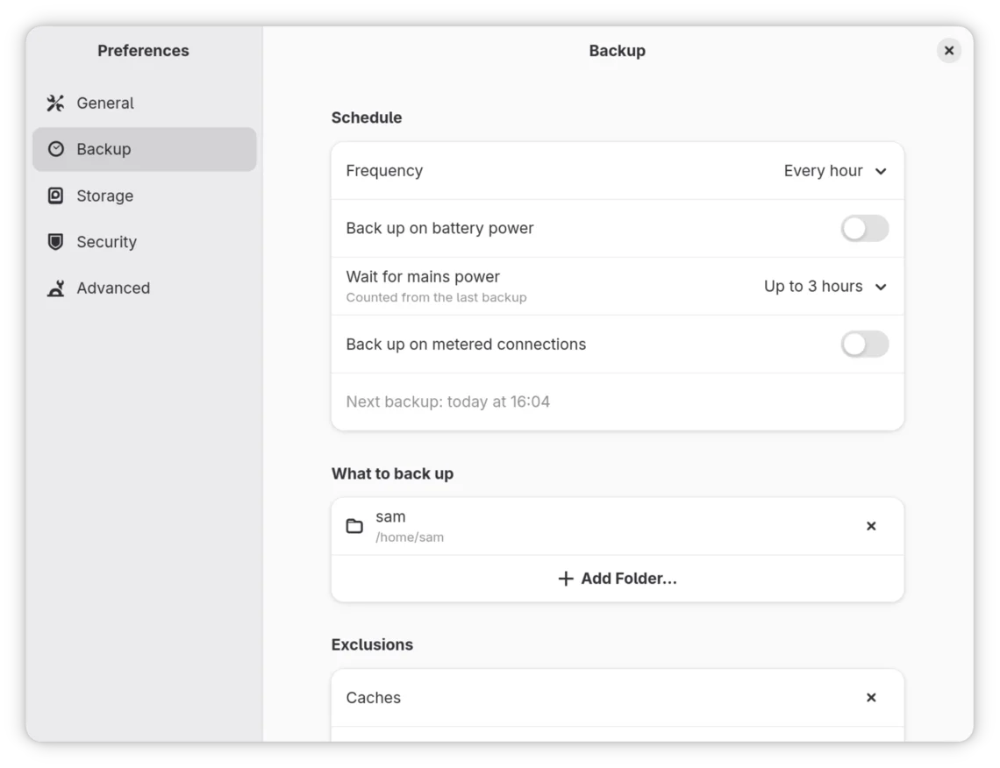
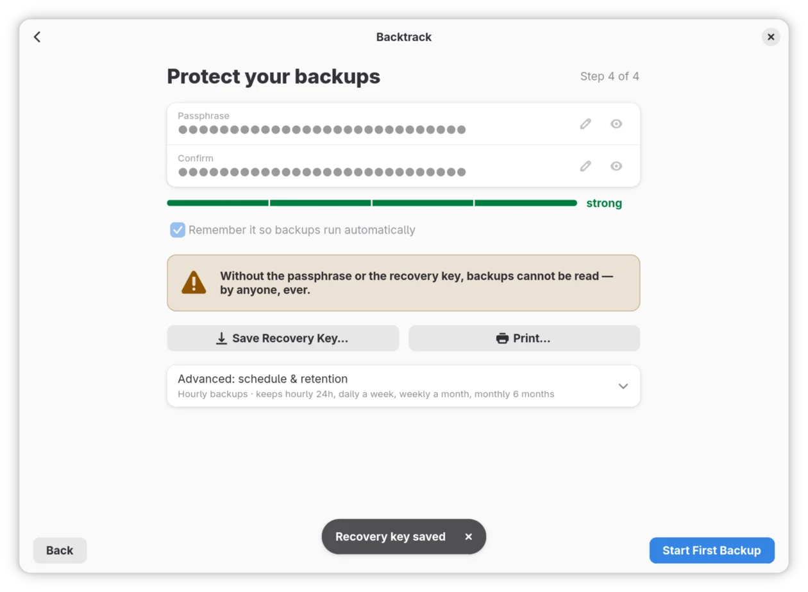

Suppose we've edited a photo, saved over it, then realised it looked better before our creative input. Getting the original back should be as simple as opening its folder as it was. That's the idea behind [Backtrack](https://backtrack.tools), my new backup app for the Linux desktop. It's basically **Apple's Time Machine, but for Linux**.

Linux backup tools tend to focus on either the whole system or traditional file backups. I wanted the feeling of stepping back in time to recover something lost or changed, which I really liked about Time Machine. So I built Backtrack around BorgBackup, a mature, proven backup tool, and concentrated on making that experience easy to use. Backtrack is independent, with no affiliation with Apple.

## Rewind the Pictures folder

Our photo is `holiday.jpg` in Pictures. The sea is now a colour not found in nature, but an earlier backup contains the original. Let's get that version back.

**Rewind** fills the screen with the folder, with earlier backups stretching away behind it and a timeline down the side. We're looking through the folder as it was, rather than working out which backup contains what.

To find our original:

1. Open Pictures in Backtrack and press <kbd>Ctrl</kbd> + <kbd>T</kbd>.
2. Press <kbd>Up</kbd> to step to an older backup, or <kbd>Down</kbd> to come forwards again. We can also jump using the timeline.
3. Find and select `holiday.jpg` in the earlier backup.

That's the copy we want. Choosing **Restore** brings it back, with a choice about what happens to today's edit, which we'll get to next.

You can also enter Rewind directly from a right-click in GNOME Files or Dolphin once the file-manager integration is installed. It's available from Backtrack's app icon and, on desktops with a tray, its tray menu too.

## Keeping today's version too

Of course, we might still think the orange sea has potential. Backtrack doesn't require an admission of artistic failure before restoring a file.

If we're undecided, **Compare with Today** in the main Backtrack window shows the older photo beside the current one. Both versions are in front of us, so we can decide whether we want the original without relying on our apparently questionable judgement from earlier.

When we restore a file that already exists, Backtrack shows both modification dates and which copy is newer. We can replace today's file, cancel, or choose **Keep Both**.

With Keep Both, our Pictures folder ends up with:

| File | What it contains |
| --- | --- |
| `holiday.jpg` | The original restored from the backup |
| `holiday (current).jpg` | Today's edited copy |

We have the original back without losing the edit. Keeping it doesn't mean we have to show it to anyone.

**Undo** reverses the last restore, including putting those names back. In the main window, the Undo offer stays until we use it or perform another restore. If we choose Replace instead, the displaced copy goes into **Recently Replaced Files**, where it stays for up to thirty days; the oldest copies can go sooner if its storage limit is reached.

## What if we've deleted it?

Let's change our mistake. This time we've deleted `holiday.jpg`, emptied the Trash and forgotten where we'd put it. We can search for part of its name rather than reconstructing the excellent filing system we were definitely going to maintain.

Press <kbd>Ctrl</kbd> + <kbd>F</kbd> in Backtrack and search for `holiday`. Search looks through file names across the backups, including files no longer on the computer. **Restore Latest Version** returns the newest backed-up copy to its original folder.

If that's the edited version and we want the original, **View in Timeline** takes us to its saved history so we can look further back. The earlier backup is what makes recovery possible after emptying the Trash.

Before the Trash is emptied, Backtrack can show its contents in the timeline too. That includes files created and deleted between hourly backups, whilst they're still in the Trash.

## Backing up without another chore

Finding that original depends on having saved a copy before we edited it. Remembering to make a backup immediately before doing something regrettable would require rather more foresight than I possess.

Once set up, Backtrack backs up every hour by default whilst you're logged in, even with its window closed. It stays quiet unless something needs your attention.

The default selection covers Documents, Pictures, Music, Downloads and Desktop, along with app settings and SSH and GPG keys. You can choose different folders instead. Backtrack looks after your files; Timeshift or Snapper can sit alongside it to handle installed programs, system settings and broken updates.

Now suppose the backup drive is unplugged when we edit our photo. Backtrack keeps changes locally and sends them on when the drive returns. That local storage has a size limit, and it is still on the laptop: if the laptop dies before those copies reach the separate drive, they go with it. Reconnecting the drive is still necessary.

It also makes allowances for actually using a laptop as a laptop. On battery, scheduled backups normally wait for the charger, but once three hours have passed since the last backup, they can run anyway. Network backups wait on connections marked metered, such as a phone hotspot. If the laptop sleeps through a scheduled backup, Backtrack catches up after waking, subject to the power and connection conditions.

So our next saved version doesn't depend on leaving the window open, keeping the laptop awake or remembering a button.

## Your backups stay yours

Underneath the browsing and restoring, BorgBackup does the backup work. I wanted an easier way to retrieve our photo, not a new file format that makes its survival depend on me personally.

New backups set up in Backtrack are encrypted on your computer before they leave it. Each backup stores changed data rather than another complete copy of everything. If Backtrack disappeared tomorrow, Borg could still read those backups.

You can keep them on a USB drive, a shared folder on another computer, or a server using SSH, a secure way to connect to that server.

Already using Vorta or Pika Backup? Choose **Already have backups?** during setup to open compatible backups for browsing, searching and restoring. Backtrack leaves backups made by those apps out of its automatic cleanup.

If the laptop itself dies, that same option is the way back in. Install Backtrack on the replacement, point it at the surviving backups and restore the backed-up files to their original locations. Our photo can come back with the rest. Keep the passphrase, and any required separate key file, safe somewhere other than the laptop.

Backtrack has **no telemetry**. It's free software under GPL-3.0-or-later, with [all the application code on GitHub](https://github.com/keithvassallomt/backtrack).

## Get Backtrack

Backtrack runs on GNOME and KDE Plasma, plus Hyprland, COSMIC, Xfce, Cinnamon, MATE and Sway. Everything works from the keyboard, Orca can read every control, and it follows your light or dark style. The [installation guide](https://github.com/keithvassallomt/backtrack/blob/main/docs/installing.md) covers Fedora, Ubuntu and Arch packages, plus a FriendlyHub Flatpak.

I built Backtrack for Linux users who want automatic file backups and a straightforward way to get something back from them. That's why the Time Machine approach is worth bringing to Linux: we should be able to find the file in its old folder, restore it and carry on.

Head to [backtrack.tools](https://backtrack.tools), install it, choose a backup destination and let the first backup finish. Save the recovery-key export away from the laptop and keep the passphrase safe.

I'll work on my photo-editing judgement separately.
