If there's one thing Python doesn't lack, it's libraries. Even a simple app often includes imports from your own code, the Python standard library, and of course third-party libraries from places like [PyPI](https://pypi.org). Released on 9th October 2026, [Python 3.15.0](https://www.python.org/downloads/release/python-3150/) aims to make that more efficient with **explicit lazy imports**, a way to put off loading a module until you actually use it.

Imagine a simple Python tool that accepts two commands:

1. Generate a status message.
2. Generate a report.

```python
import report_backend

def run(command):
    if command == 'status':
        return 'Ready'
    elif command == 'report':
        return report_backend.render()
    else:
        raise ValueError(command)
```

When we use `run('status')`, we need to wait for the entire `report_backend` to load before our simple tool returns a string. Let's fix that with lazy imports.

## Using lazy imports

Here's the same code, but with a lazy import:

```python
lazy import report_backend

def run(command):
    if command == 'status':
        return 'Ready'
    elif command == 'report':
        return report_backend.render()
    else:
        raise ValueError(command)
```

Looks similar, doesn't it? We've simply added a [lazy declaration](https://docs.python.org/3.15/reference/simple_stmts.html#lazy-imports) at the module scope. Here's what it looks like:

```mermaid
flowchart LR
    A["run(command)"] --> B{"Command?"}
    B -->|status| C["Return 'Ready'"]
    C --> D["Backend stays unloaded"]
    B -->|report| E["Load report_backend on first access"]
    E --> F["Call render()"]

    style D fill:#16271d,stroke:#8cd49c
    style F fill:#132235,stroke:#79c0ff
```



Take the `status` branch - the `report_backend` import isn't used there, so the module simply isn't loaded. For the `report` branch, it _is_ loaded, but only when first accessing it (i.e. `report_backend.render()`).

The key takeaway here is that:

- Unused work disappears.
- Necessary work gets postponed.

## Then, we screw it up

Of course, we want our code to ~~look pretty~~ be maintainable. So, we replace the branching with a dispatch dictionary. Our code now looks like this:

```python
lazy import report_backend

HANDLERS = {
    'report': report_backend.render
}

def run(command):
    if command == 'status':
        return 'Ready'

    handler = HANDLERS.get(command)
    if handler is None:
        raise ValueError(command)

    return handler()
```

We've just defeated the whole purpose of lazy imports. On line 4 of our new code, Python has to evaluate `report_backend.render` to put the function into the dictionary. That accesses the imported name, which triggers loading whilst the dictionary is being constructed. This means it will **always** load, even if we're just calling `status`.

> You've deferred loading until first use, then helpfully arranged for the first use to happen immediately.

Keeping the access inside the reporting function, as in the original example, leaves it to load only on the reporting path. So, when you consider making an import lazy, follow the name through the surrounding code too. Setup code that collects functions or constructs objects can bring loading straight back into startup.

Of course, this doesn't mean we couldn't still use that handler. Here's how:

```python
lazy import report_backend

HANDLERS = {
    'report': lambda: report_backend.render()
}

def run(command):
    if command == 'status':
        return 'Ready'

    handler = HANDLERS.get(command)
    if handler is None:
        raise ValueError(command)

    return handler()
```

Here we're using `lambda`. This creates a function that, when called, accesses our `report_backend.render()` function. The important bit is that this only happens when the lambda is called, not when it's being put in the dictionary.

## Now the backend is missing

Let's give our tool another problem: the reporting library isn't installed.

With a normal import, our tool doesn't work at all. The library is loaded immediately, so if it's not there, the tool fails immediately too. With lazy imports, our `status` branch still works. Of course, `report` will still fail due to the missing library.

Now, you could argue that our code doesn't make much sense now; after all, if the point of a reporting library is to generate reports, reporting a `Ready` status is fairly disingenuous if the reporting library doesn't exist. However, my counter-argument to that is that our status branch was never much of a status at all - it simply returned a string. Let's make it actually check the status, without losing our lazy import:

```python
import importlib.util
lazy import report_backend

HANDLERS = {
    'report': lambda: report_backend.render()
}

def run(command):
    if command == 'status':
        if importlib.util.find_spec('report_backend') is None:
            return 'Report backend missing'
        return 'Ready'

    handler = HANDLERS.get(command)
    if handler is None:
        raise ValueError(command)

    return handler()
```

By using `find_spec()`, we're checking the library exists before reporting our status and, crucially, we're not actually loading it, which would defeat the purpose of lazy imports.

Of course, we're only checking the library exists - not that it works - but if anything we're at least making the status branch more honest.

## The ideal scenario

[PEP 810 recommends explicit initialisation functions](https://peps.python.org/pep-0810/#how-do-lazy-imports-affect-modules-with-import-time-side-effects) for modules that register things when they're imported. Call the registration deliberately when it's needed, and check that it has happened before using the feature. That makes the dependency visible instead of leaving an otherwise unused import responsible for quietly setting everything up.

With this recommendation, our code would be:

```python title="report_backend.py"
def render():
    return "Report generated"

def register(handlers):
    handlers['report'] = render
```

```python title="app.py"
lazy import report_backend

HANDLERS = {}
reports_registered = False

def enable_reports():
    global reports_registered
    report_backend.register(HANDLERS)
    reports_registered = True

def run(command):
    if command == 'status':
        return ('Reports ready' if reports_registered
                else 'Reports not initialised')

    handler = HANDLERS.get(command)
    if handler is None:
        raise ValueError(command)

    return handler()
```

Now:

- `run('status')` doesn't load the backend and accurately reports its initialisation state.
- `enable_reports()` loads the backend and explicitly registers its handler.
- `run('report')` works after registration.

**Caveat**: Being installed, being imported, being initialised, and being operational are four different states. Checking one doesn't necessarily prove the others!

## They earn their keep

I think lazy imports are a useful addition to Python, particularly for tools with several commands that need different dependencies. It lets a simple command stay simple without loading everything the application knows how to do. If a run needs those dependencies anyway, you're mainly choosing when it pays the loading cost.

That's still a useful choice, but a faster arrival at ‘ready’ followed by the same wait isn't a faster completed job. It's the software equivalent of being shown to your table before anyone checks whether the kitchen is open.

For our tool, I'd retain deferral if it lets status avoid irrelevant work and leaves the delay and possible failure at an acceptable point when reporting is selected. If reporting must already be available when the application announces readiness, check it during initialisation instead. That gives you a concrete decision based on both the initial response and the completed operation, rather than one flattering startup number.

I, for one, will be using lazy imports. Somehow, having `lazy` sprinkled in my code makes it match my approach to life better ;)
