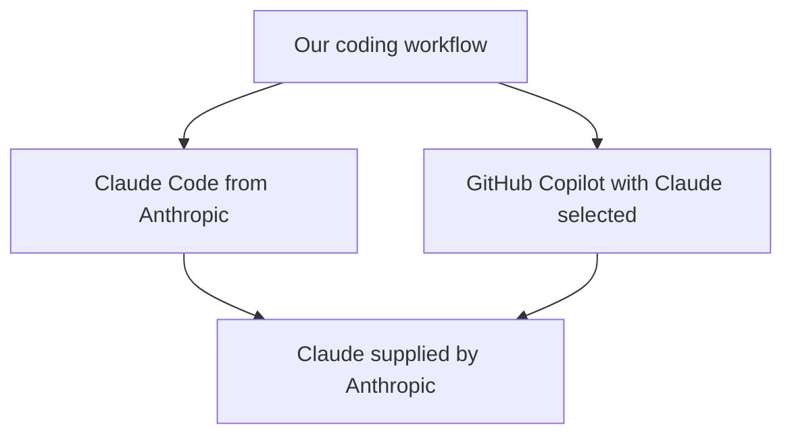

On 26th October, [Reuters reported](https://live.euronext.com/en/financial-news/china-ai-bubble-has-already-burst) that China's STAR50 index had fallen 40% in less than four months. This is a [broader technology index](https://www1.hkexnews.hk/listedco/listconews/sehk/2026/0427/2026042700565.pdf), not a collection exclusively of AI companies, but the report's headline declared that China's AI bubble had already burst.

Useful technology, unrealistic financial expectations. That's the problem, and I blame the business people who bet their companies on it, along with the speculators and venture capitalists who fund hype rather than businesses that make money. Apparently, writing useful software now also requires engineers to guarantee the winnings.

If you use AI for coding, this matters when choosing what you can't do without. I primarily use Claude Code and Codex because I prefer the model suppliers' own tools to relying on another product on top. Let's follow one choice: Claude through GitHub Copilot, or through Anthropic's Claude Code. What does Copilot add, and is it worth depending on?

## Choosing where to use Claude

Here's the product choice, leaving out the hosting plumbing:

Both routes give us access to Claude. Through Copilot, we also rely on GitHub's decisions about available models, integration and charging. I don't want to collect subscriptions I can't do without as though I'm trying to complete a set.

Claude helping us write code doesn't tell us whether Anthropic makes money supplying it, or whether its investors will get the returns they expect. An impressive demonstration answers the question about the code. The people investing still have their own homework to do.

[Anthropic's filing of 26th October](https://www.sec.gov/Archives/edgar/data/2130357/000162828026067168/anthropicpbc-sx1.htm) reported a US$693 million loss on its operations in the first half of 2026, despite making US$974 million on the same measure in the quarter ending 30th June. Those are operating figures, not net profit or cash flow. Neither figure turns a useful coding assistant into a guaranteed investment.

My preference is straightforward: I don't want another product to become essential to my work if its business stops making sense after its model supplier changes the deal.

## The bill, because apparently that matters

Our coding assistant doesn't have to disappear before those decisions affect us. Changing how we're charged is enough to make us redo the sums, which is an irritating extra task for something bought to save us work.

On 27th April, [GitHub announced a billing transition beginning on 1st June](https://github.blog/news-insights/github-copilot-is-moving-to-usage-based-billing/). For plans covered by the transition, the amount of work within an interaction matters to its cost, rather than simply counting the interaction:

| Previous accounting | Announced replacement |
| --- | --- |
| Premium requests | AI Credits based on input, output and cached tokens |

GitHub attributed the change to the compute demands of agentic work, describing the previous request model as ‘no longer sustainable’. Base plan prices stayed unchanged, and existing annual individual plans had exceptions.

With Claude selected in Copilot, the model and its token consumption affect how many credits an interaction uses. We can like the answers perfectly well and still need to reconsider how much work to put through it. The technology remains useful; the rules for paying for it have changed.

That's already enough reason for me to care about what sits underneath an AI tool. Waiting until something disappears would be a rather late start.

## Why I prefer the suppliers' own tools

Copilot's integrations and [model choices](https://docs.github.com/en/copilot/reference/ai-models/model-hosting) make switching convenient, but they don't give me enough reason to make another product essential. Its menu includes Anthropic, OpenAI, Google and Microsoft's own model, so we can select a different model without replacing Copilot.

However, going to the supplier doesn't mean being left with a bare model and a determined expression. [Anthropic's Claude Code](https://support.claude.com/en/articles/14553413-claude-code-cheatsheet) includes tools for reading and editing files and running commands, whilst [OpenAI offers Codex](https://openai.com/codex/). These are coding products with tools around the models, rather than capabilities magically contained in the model itself.

More of what Replit, GitHub Copilot, Lovable and their ilk sell will end up in the model suppliers' own products. I don't want to build my setup around an extra subscription, only to find that the bit I need is available from the supplier anyway.

Of course, choosing Anthropic doesn't freeze Claude in place. Its [retirement policy](https://platform.claude.com/docs/en/about-claude/model-deprecations) spells out what happens to applications using particular models:

- Requests to retired models fail.
- Affected applications need updating, with replacements tested before retirement.

The direct route in our diagram still leaves us with Anthropic's changes to handle. That's precisely why I cut out the extra product where I can, rather than add another set of product and billing decisions to the things I already rely on.

## Who should carry the losses?

[Alexis Goldstein's 27th October op-ed](https://truthout.org/articles/as-the-ai-bubble-threatens-to-burst-we-must-prepare-to-fight-a-big-tech-bailout/) argues against the public absorbing losses if AI firms falter. My boundary is straightforward:

> Protect essential services, not shareholders.

Shareholders bought an investment, not a money-back guarantee. If a genuinely necessary service depends on this technology, keeping that service running is a different job from restoring an investor's valuation. Taxpayers aren't the extended warranty on somebody else's bet.

Public support should pay for what people genuinely need to keep using. ‘The technology is useful’ is a rotten argument for ‘please reimburse the shareholders’. The business people and funders made those bets, and they're responsible for them.

## What I'd actually depend on

I'll keep using AI, and my preference remains Claude Code and Codex. For coding work, I'd rather use the model suppliers' own tools than build around an additional product whose future depends on what its supplier decides to charge or provide.

If you're choosing where to use Claude, our diagram gives you three blunt questions to answer before making Copilot something you can't do without:

1. Who actually supplies the model?
2. What does Copilot add that I need?
3. If access or charging changes, what would I have to change?

AI is worth using. That doesn't make every business built around it sensible, excuse venture capitalists funding hype, or oblige the public to protect their investments. The unrealistic financial expectations belong to the people making and funding the bets, not the engineers who built useful technology.

I wanted a coding assistant. I've somehow acquired business-model homework.
