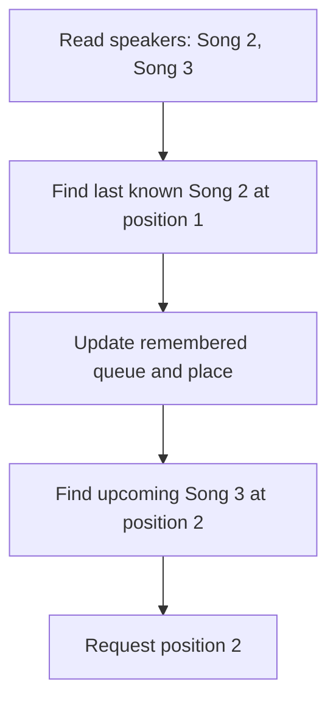

[GuildFM](https://github.com/keithvassallomt/guildfm) is my office music project. People request songs and vote from their phones or laptops, and it plays them on Sonos speakers. It also has AI radio stations with a DJ and spoken announcements, so naturally this fix concerns the slightly less glamorous business of playing the next song.

The [30th October fix commit](https://github.com/keithvassallomt/guildfm/commit/39671538010da42cdd51a0afdac8ab01eb2dcbd4) records the speakers stopping after a DJ line and remaining silent for three minutes, until someone pressed Play. GuildFM already had recovery for a stalled song. Unfortunately, its retry requested a queue position the speakers no longer had.

The repair reads the speakers' queue before working out where to play, then handles a rejected command differently from a speaker that isn't answering. If you control another service using your own copy of its state, this is a useful failure to understand.

## Two queues, one missing item

GuildFM remembers what it queued and its place in that list. The speakers hold a separate queue. In the incident, GuildFM still remembered a DJ clip that was missing from the speakers' queue.

The [regression test](https://github.com/keithvassallomt/guildfm/blob/main/tests/test_keeping_place.py) reduces that disagreement to three songs, rather than reproducing the exact historical queue. Let's follow its simplified version: Song 2 was last playing, Song 3 is lined up, and we remove Song 1 only from the fake speakers.

| Queue | Position 1 | Position 2 | Position 3 |
| --- | --- | --- | --- |
| Both, before removal | Song 1 | Song 2 | Song 3 |
| GuildFM, after removal | Song 1 | Song 2 | Song 3 |
| Fake speakers, after removal | Song 2 | Song 3 | No item |

When we simulate the stall, GuildFM preserves its remembered place instead of adopting the stopped speakers' reset position. It still remembers Song 2 at position 2, with Song 3 next at position 3.

So the old retry asks the speakers to play position 3. You can see the problem in the table: they only have two items. **Song 3 still exists, but its old position doesn't.**

I can't even blame an off-by-one error here: GuildFM's [speaker adapter](https://github.com/keithvassallomt/guildfm/blob/main/src/guildfm/speakers.py) correctly converts its one-based positions to the zero-based indices used by SoCo, the Sonos control library. We're counting through the wrong list.

## Find the song again

The change is in `play_again()`: before searching for the song, read the queue again. Here's the current method from [`PlaybackController`](https://github.com/keithvassallomt/guildfm/blob/main/src/guildfm/playback.py), with its docstring omitted:

```python title="playback.py"
async def play_again(self, item: QueueItem) -> bool:
    self._require_control()
    await self._match_queue()
    ahead = range(self._position, len(self._items))
    index = next((i for i in ahead if self._items[i].key == item.key), None)
    if index is None:
        return False
    await self._call(self._speakers.play_position, index + 1)
    self._settle()
    await self.poll()
    return True
```

The added `await self._match_queue()` updates our list and remembered place before `ahead` is calculated. If you leave that call out, the search finds Song 3 in the old list and produces the same invalid position again.

`_match_queue()` fetches the speakers' queue and compares the ordered track keys with GuildFM's copy. A key comes from the normalised track URI, not the title or numeric position. If the lists disagree, it works backwards through the remembered items up to the old place, looking for the latest surviving item in the actual queue.

In our example, that surviving item is Song 2. It hasn't disappeared; it's moved to position 1. The repair follows it:



Now `index + 1` produces 2 rather than 3. We're retrying the same song, but finding its position again instead of trusting the old number.

Reading the queue and sending the command remain separate operations. This doesn't prevent another queue change between them; it stops this retry from being calculated using an already outdated list.

## When the retry is refused

That fixes the stale position. It doesn't mean the speakers will accept every retry.

For the second regression, we reset the same three-song queue. This time Song 2 is lined up, and the fake speakers are configured to reject its retry. We want Song 3 to play instead of holding everything up for Song 2.

Of course, you need to distinguish that rejection from being unable to reach the speakers. GuildFM distinguishes `SpeakersUnavailable`, meaning they cannot be found or aren't answering, from `SpeakersRefused`, meaning they answered but rejected the command.

This is the relevant part of [`keep_fed()`](https://github.com/keithvassallomt/guildfm/blob/main/src/guildfm/queue.py), after it records which song is being retried:

```python title="queue.py"
try:
    if await controller.play_again(self.item(lined_up)):
        return
except SpeakersUnavailable:
    self._retried = None
    log.warning("Couldn't reach the speakers to try %s again", title)
    return
except SpeakersRefused as error:
    log.warning("The speakers wouldn't try %s again: %s", title, error)

await self._let_go(db, lined_up)
lined_up = None
```

The two exceptions now lead to different outcomes:

- **Unavailable:** clear the retry marker and return, keeping the song so another attempt is possible later.
- **Refused:** log the rejection and continue into `_let_go()`, which attempts to remove the failed song, deletes its database entry and records the skip.

The rest of `keep_fed()` can then select another song. In this test, that's Song 3. A `False` result from `play_again()` follows the same skip path: there's no matching upcoming item to retry.

## Test the recovery's failure too

Both regressions simulate a song failing to start and take three speaker readings before checking what happens. You need to check more than whether a retry was attempted:

- After Song 1 disappears only from the speakers, Song 3 must be selected, transport must be `PLAYING`, GuildFM must show Song 3, and the logs must contain `out of step`.
- After the retry of Song 2 is refused, GuildFM must show Song 3, transport must be `PLAYING`, and Song 2 must no longer be in the speakers' queue.

The repair also logs the speakers' reported position and title alongside GuildFM's remembered position and list. For our shortened queue, that means a future incident record can show both views, rather than an invalid position with no explanation of where it came from.

I think the extra queue read is worthwhile here. If you maintain a controller that turns remembered remote state into positional commands, I'd test this sort of disagreement as well as a temporary failure to answer. I'd also test an explicit rejection, because GuildFM needs to move on in that case, not simply arrange another identical attempt.

The [GuildFM repository](https://github.com/keithvassallomt/guildfm) has the implementation and regression tests. This repairs the stale-queue retry and refusal paths, not every possible playback stall.

I've certainly found a complicated way to avoid pressing Play.
